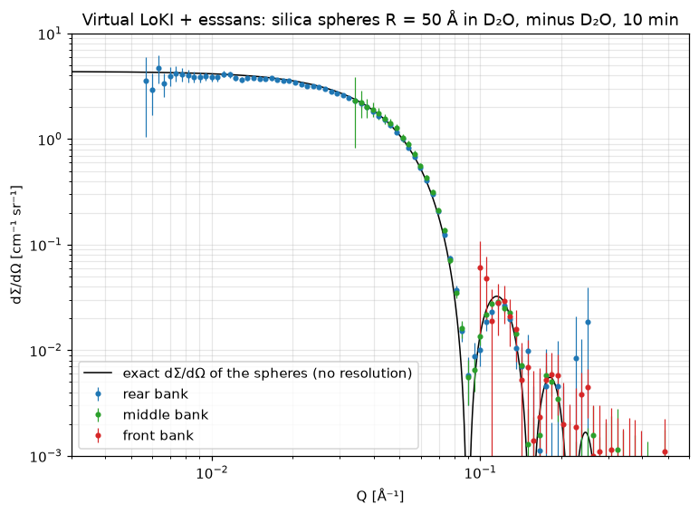

# Digital twin of LoKI (small-angle neutron scattering, ESS) — first version

*Started 2026-11-03.* LoKI measures small-angle neutron scattering (SANS) by time of flight: the size, shape and
arrangement of objects from ~1 to ~100 nm (particles, pores, polymers, membranes). This folder is the start of its
digital twin, built like the ODIN twin (`../odin/`), from the official McStas model of LoKI and from the French LoKI
notebook series of this project, where every step of the simulation and of the reduction is explained and validated.

**Status: first version, one easy test case, three collimations, two detector distances, pulse skipping (below).** Driven from Python, from the console (`twin_server.py
--instrument loki` + `twin_console.py`) or from NICOS (`../nicos/start_nicos.py --instrument loki`, ESS GUI and
device names `heavy_shutter`, `fast_shutter`); data analyzed in `LoKI_analysis.ipynb`. Not yet: raw event files
in the ESS NeXus format, reduction with the ESS software (`esssans`), the full series of measurements of a real SANS
experiment (empty cell, solvent, dark, water calibration), web page, container.

## Easy test case: dilute silica spheres

```
python easy_case.py
```
Silica spheres of radius R = 50 Å, 1 % in volume in D₂O, 1 mm thick; 3 m collimation (rear detector at 5 m);
10 min of measurement. Their scattering is known exactly (`loki_samples.silica_spheres`):
dΣ/dΩ = φ V Δρ² P(Q) + background, I(0) = 4.37 cm⁻¹, minima of P(Q) at 0.090 and 0.155 Å⁻¹.



Result (2026-11-04): the three detector banks join up and follow the exact curve; Guinier fit (Q Rg < 1.3, 26 points):
**Rg = 39.4 ± 0.2 Å (exact 38.7 Å), I(0) = 4.31 ± 0.01 cm⁻¹ (exact 4.37)**; mean level in the Guinier region 0.984
of the exact one. The apparent Rg is 1.8 % too large because the instrument resolution smears the curve (it also
fills in the minima); it is not corrected here. The first run takes ~2 min (McStas compilation and downstream
simulation, then cached).

## Configurations

What can be changed, as on the instrument (devices of `VirtualLoki`, same names in NICOS):

| Device | Values | Effect |
|---|---|---|
| `collimation` | `3m`, `5m`, `8m` | upstream part of the official model; longer: smaller divergence (lower Q, better resolution), less flux. Source / sample apertures 30/10 mm (3 m), 20/10 mm (5 m, 8 m); band 3–11.5 Å (3 m, 5 m), 3–10 Å (8 m) |
| `pulse_skipping` | `off`, `on` | `on`: choppers at 7 Hz, one source pulse in two, band 3–21.4 Å (3 m collimation only) |
| `detector_distance` | 5, 10 m | rear detector bank (the middle and front banks do not move); farther: lower Q |

The configurations are those of the LoKI notebook series (notebooks 01–03), where the upstream parts were computed and
checked; the pulse-skipping upstream part was computed for the twin (10⁹ neutrons). Each is a precomputed upstream
part (release asset, `../container/fetch_fronts.py --instrument loki`); a combination that does not exist is refused
with the list of the available ones.

**Read-only values** (`VirtualLoki.readings()`, NICOS devices of the setup `choppers`): speed of the two chopper pairs
of the model, bandwidth chopper `ch1` (6.5 m from the source) and frame-overlap chopper `ch2` (15.21 m), 14 Hz or 7 Hz,
and the opening delay of each disc (`ch1a_delay`, `ch1b_delay`, ...), computed from the wavelength band with the
formulas of the model (`includes/loki_functions.c`; checked against the values printed by the compiled model, to the
μs, for 3 m / 3–11.5 Å, 8 m / 3–10 Å and pulse skipping / 3–21.4 Å); `wavelength_band`.

**Pulse skipping in the twin**: the arrival times are unwrapped with a period of 2/14 s, and the count rates are
halved (McStas simulates one pulse, which the choppers let through, with weights in neutrons per second as if every
pulse came; I(Q) is a ratio and does not change, but the counting noise of a t-second measurement does).

**Validation** (2026-11-04, silica spheres of the easy case, 10 min, Guinier fit Q Rg < 1.3 on all banks; exact
Rg = 38.7 Å, I(0) = 4.373 cm⁻¹):

| Collimation / detector | Rear bank Q range [Å⁻¹] | Rg [Å] | I(0) [cm⁻¹] | Level / exact (Guinier region) |
|---|---|---|---|---|
| 3 m / 5 m | 0.0115–0.258 | 39.4 ± 0.2 | 4.311 | 0.984 |
| 3 m / 10 m (now refused: frame overlap) | 0.0078–0.184 | 39.2 ± 0.2 | 4.178 | 0.956 |
| 5 m / 5 m | 0.0115–0.258 | 40.1 ± 0.2 | 4.396 | 0.994 |
| 5 m / 10 m (now refused: frame overlap) | 0.0078–0.184 | 39.3 ± 0.2 | 4.222 | 0.965 |
| 8 m / 10 m | 0.0082–0.184 | 39.9 ± 0.2 | 4.374 | 0.992 |
| 8 m / 5 m | 0.0120–0.258 | 39.8 ± 0.2 | 4.380 | 0.993 |
| 3 m, pulse skipping / 5 m | 0.0106–0.258 | 39.9 ± 0.2 | 4.357 | 0.987 |
| 3 m, pulse skipping / 10 m (now refused: frame overlap) | 0.0075–0.176 | 39.1 ± 0.2 | 4.285 | 0.981 |

All within 5 % of the exact values. Pulse skipping, checked neutron by neutron: the wavelength rebuilt from the
arrival time (period 2/14 s) differs from the true one by +3 % (median), as without pulse skipping (+4 %: the long
ESS pulse, the reduction assumes the mean emission time), with no frame error; the incident flux is halved
(7.8·10⁸ → 4.0·10⁸ n/s on the sample, 3 m). The longest wavelengths are few, so the rear bank gains little at low Q
(0.0106 instead of 0.0115 Å⁻¹ at 5 m); the gain is a wider Q range in one setting (front bank from 0.136 Å⁻¹). Rg comes out 1–4 % too large in every configuration (resolution, not corrected).
**Frame overlap** (explained 2026-11-04): with the band 3–11.5 Å and the rear detector at 10 m, the neutrons of one
pulse reach the detector over 82 ms (fastest 3 Å to slowest 11.5 Å, pulse length included), more than the 71.4 ms
between two pulses: the slowest neutrons of a pulse arrive with the fastest of the next one, and get a wrong wavelength
(checked neutron by neutron: 1.9 % of the rear-bank neutrons with an error above 30 %), hence the 4 % low level. With
pulse skipping (3–21.4 Å, 142.9 ms between pulses used) the same happens at 10 m (166 ms; 0.3 %). This is why the 8 m
configuration uses 3–10 Å (69 ms at 10 m). On the instrument the band is chosen with the detector distance; the twin
now refuses a setting with frame overlap (`VirtualLoki.move`, computed from the band, the distance and the period),
with the explanation. Allowed: 3 m / 5 m, 5 m / 5 m, 8 m / 5 m, 8 m / 10 m, 3 m pulse skipping / 5 m. Computing time: < 30 s for a
configuration already simulated, ~1 min for a new one; peak memory 4.4–5.6 GB (8 MPI processes).

## How it works

| Step | Where | What |
|---|---|---|
| Upstream part | `loki_mcstas.front` | official `LOKI_main.instr` cut just before the sample, MCPL file of the neutrons at the sample (computed once per configuration: ~15 min for 10⁹ neutrons on 8 cores, ~1.4 GB RAM per process) |
| Sample | `loki_mcstas.back`, `components/SANS_Iq_table.comp` | McStas downstream part: the sample scatters with a tabulated dΣ/dΩ(Q) in absolute units; scattered neutrons to an MCPL file, transmitted beam to wavelength monitors |
| Detector | `loki_mcstas.Detector` | the 9 tube panels of the official model (front, middle, rear banks), straight lines from the sample to the first panel met, beam stop, masks of hidden pixels |
| Time of flight | `loki_mcstas.events` | arrival time modulo the source period (2/14 s with pulse skipping), frames unwrapped, λ = h t / (m L), Q = 4π sin θ / λ |
| Reduction | `loki_mcstas.reduce` | I(Q) in absolute units per bank: counts / (flux × transmission × thickness × solid angle) |
| Instrument | `virtual_loki.VirtualLoki` | devices (`heavy_shutter`, `shutter`, `collimation`, `pulse_skipping`, `detector_distance`, `sample`), `move`, `count(t)` → HDF5 file with I(Q) and errors per bank (counting noise of a `t`-second measurement + simulation noise), live image of the rear panel, logbook `log.jsonl`; same interface as `VirtualOdin`, so the twin server and NICOS drive it |

## Files

| File | Role |
|---|---|
| `loki_paths.py` | paths: official model `LOKI_REPO` (default `~/McStas_runs/LOKI`), results `<TWIN_RUN_ROOT>/loki/` |
| `loki_mcstas.py` | McStas engine (English copy of the engine of the LoKI notebook series, same physics) |
| `loki_samples.py` | samples (dΣ/dΩ in cm⁻¹ sr⁻¹): `silica_spheres` |
| `virtual_loki.py` | the virtual instrument (`VirtualLoki`, `read`) |
| `easy_case.py` | the test case above and its figure |
| `gen_analysis_notebook.py` → `LoKI_analysis.ipynb` | analysis notebook (JupyterLab): logbook, file content, I(Q) of the three banks, Guinier fit (Rg), sphere-model fit (R, background), volume fraction from I(0); on any session or proposal folder (demonstration, 10 min: Rg = 39.4 ± 0.2 Å, R = 49.6 Å, φ = 1.00 %) |
| `components/SANS_Iq_table.comp` | McStas sample component (isotropic SANS from a table, absolute units) |

## Installation

Same environment as the ODIN twin, plus the official LoKI model:
```
git clone https://git.esss.dk/dmsc-instrumentmodels/LOKI.git ~/McStas_runs/LOKI
```
The upstream part of the 3 m configuration (`front/col3m_src30mm_sam10mm_lam3-11.5_skip0_N1e+09/`, 54 MB) is
downloaded from the release of this repository (`python ../container/fetch_fronts.py --instrument loki`, asset
`loki_front_...tar`); otherwise it is computed by `loki_mcstas.front()` on first use (~15 min on 8 cores). With the
upstream part present, the official model is not needed to measure.

**Container**: the image contains the official model (fixed commit, `LOKI_REPO=~/loki_model`) and downloads the
upstream part at start. Checked on 2026-11-04 from an empty results folder, without the official model, 4 MPI
processes: the easy case takes 2 min (compilation + downstream part), Rg = 39.3 ± 0.2 Å, I(0) = 4.33 cm⁻¹, peak memory
5.6 GB. The smoke test of the container runs it at every push. Number of McStas processes: variable `TWIN_MPI`
(default 8).

## Next steps
1. Raw data: event files in the ESS NeXus format of LoKI, reduced with `esssans` (as ODIN with `essimaging`).
2. A real SANS session: empty beam, empty cell, solvent, sample, dark, water (absolute calibration), with
   transmissions; the samples of the notebook series (Nafion membrane, catalyst layer, porous electrode).
3. Done on 2026-11-04: collimations 5 m and 8 m, rear detector at 5 or 10 m, pulse skipping (§ Configurations).
   To do: understand the 4 % low level with a short collimation and the detector at 10 m; more samples.
4. Done on 2026-11-04: twin server, console and NICOS (`../nicos/nicos_twin/loki/`, ESS GUI of LoKI), analysis
   notebook, container image, live data with Kafka and just-bin-it (rear panel, sample of the neutrons;
   `../nicos/README.md`, "Live data"). Still to do: web page.
