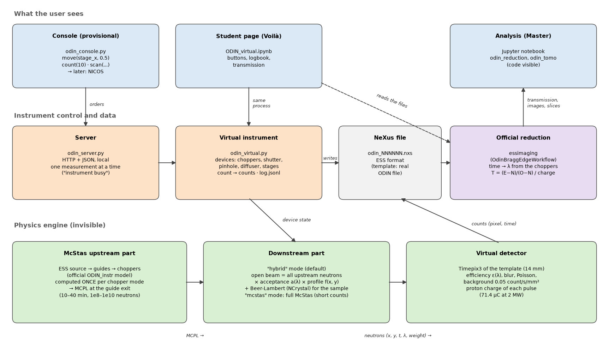
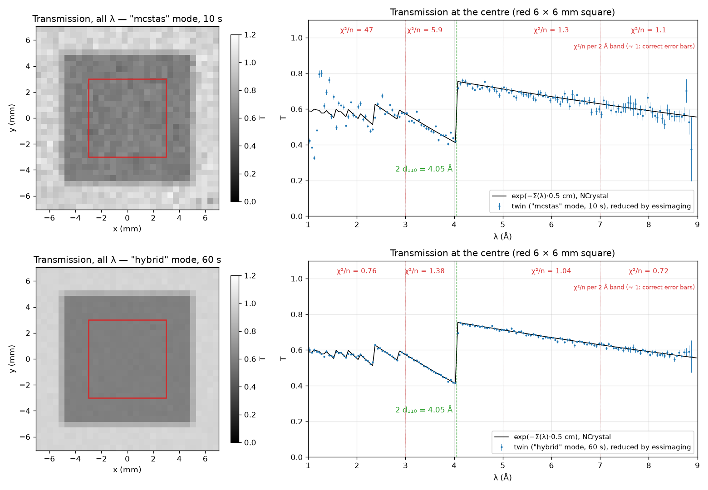
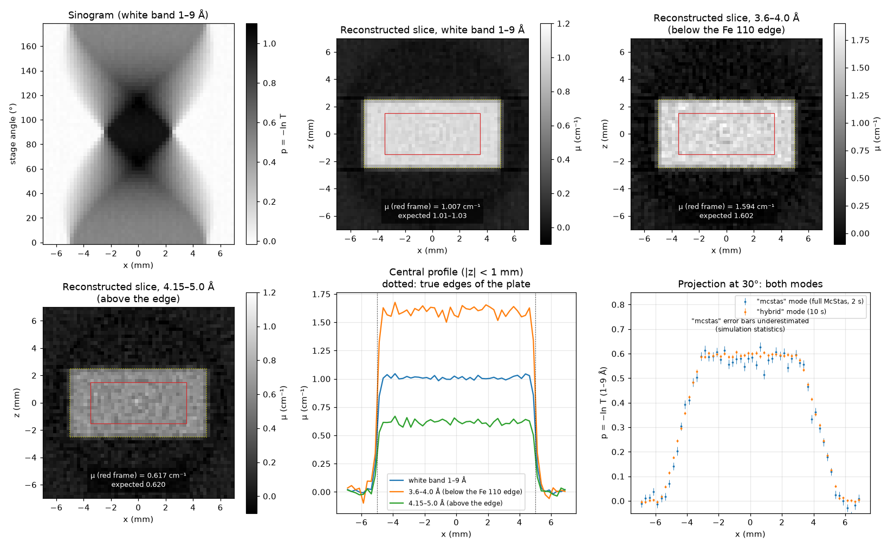
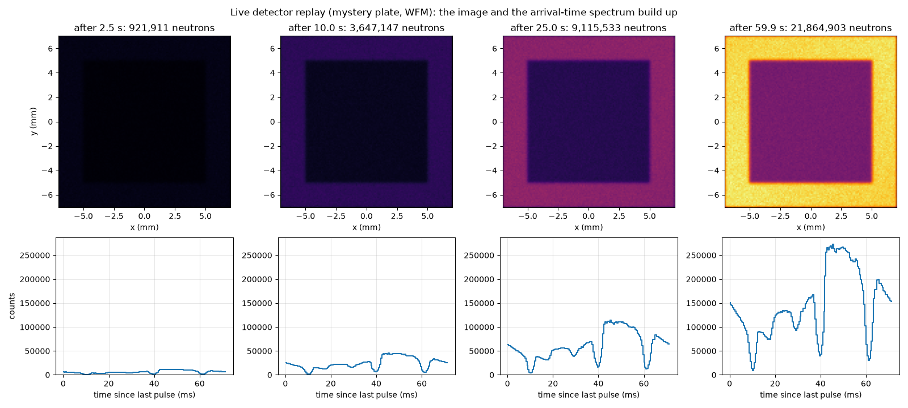
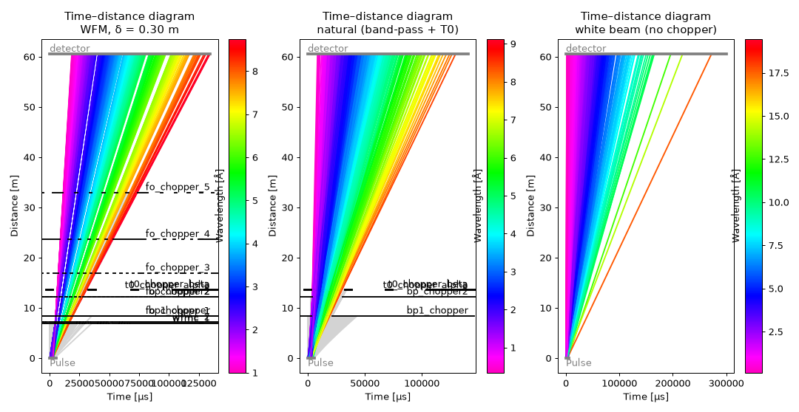
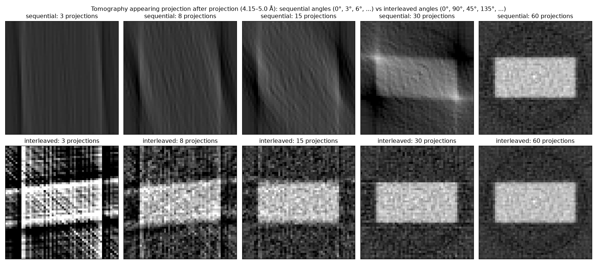
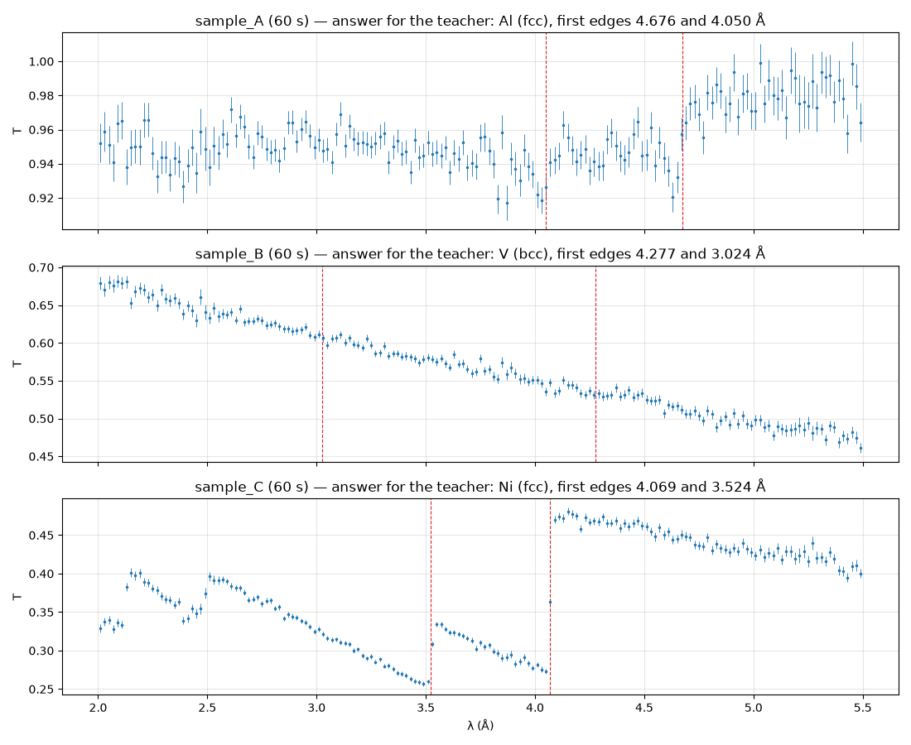

# ODIN digital twin: complete guide

*Created 2026-11-03.* Part of the ACCESS digital twins (`../README.md`). NICOS: `../nicos/README.md`.
This folder contains a virtual ODIN that is operated like the real instrument, writes NeXus files in the ESS format,
and whose data go through the official ESS reduction code (`essimaging`). It is a teaching tool: everything is
explained, and every approximation is stated and checked.



*(`fig_chain.py`)*

## Contents
1. [What is in this folder](#1-what-is-in-this-folder)
2. [Requirements and installation](#2-requirements-and-installation)
3. [Getting started, step by step](#3-getting-started-step-by-step)
4. [How it works](#4-how-it-works)
5. [Devices](#5-devices)
6. [Chopper modes](#6-chopper-modes)
7. [Choices, limits and open questions](#7-choices-limits-and-open-questions)
8. [Troubleshooting](#8-troubleshooting)
9. [Validation](#9-validation)
10. [NICOS](#10-nicos)
11. [Games and visualisations](#11-games-and-visualisations)

## 1. What is in this folder

| File | Role |
|---|---|
| `odin_virtual.py` | the virtual instrument: devices (`move`), counting (`count`), `scan`, numbered files, log |
| `odin_hybrid.py` | downstream part in "hybrid" mode (default): open beam + attenuation by the sample |
| `components/Graphite_Diffuser_focus.comp` | McStas graphite diffuser with importance sampling ("mcstas" mode and construction of the hybrid model) |
| `odin_nexus.py` | measured counts (detector, source) and writing of the NeXus file in ESS format; chopper settings |
| `odin_reduction.py` | reduction: `essimaging` + dark run, proton charge, open beam → transmission (image and spectrum) |
| `odin_tomo.py` | tomography: sinogram from a rotation scan, filtered back-projection |
| `odin_paths.py` | paths (ODIN notebook series, results, build folder); imported first by every module |
| `../twin_server.py` | the instrument in its own process, driven over the (local) network (`--instrument odin`) |
| `../twin_console.py` | provisional control station with NICOS commands |
| `../nicos/` | NICOS setup package and launcher (`start_odin_nicos.py`) |
| `example_session.py` | example session script for the console |
| `gen_student_page.py` → `ODIN_virtual.ipynb` | student page (Voilà): operate, live replay, chopper diagram, logbook review, reduce, questions |
| `gen_mission_page.py` → `ODIN_mission.ipynb` | game page (Voilà): mission "unknown metals" with beamtime budget and score, mission "something is wrong" |
| `odin_games.py` | missions (`MetalMission`, `Troubleshooting`) and automatic logbook review (`review_log`, badges) |
| `odin_viz.py` | live detector replay, chopper time–distance diagram, progressive tomography, players for the pages |
| `show_3d.py` | 3D view of the neutrons flying through ODIN (McStas `mcdisplay`, WebGL, in the browser) |
| `fig_*.py` → `figures/` | figures of this README |
| `odin_mcstas.py` | McStas engine: upstream and downstream parts of the official ODIN model, `Runner` (compile, MPI, cache), MCPL reading, chopper table (English copy of the engine of the French ODIN notebook series, same physics) |
| `odin_paths.py` | paths (results folder `TWIN_RUN_ROOT`, build folder) |
| `build/` | McStas instruments of the twin, compiled on first use |

Results are outside the repository (and outside OneDrive): `<TWIN_RUN_ROOT>/odin/`, with `TWIN_RUN_ROOT` an
environment variable, default `~/McStas_runs/twin` (`C:/Users/<user>/McStas_runs/twin` on Windows). The path must not
contain spaces (McStas command line). Folders, relative to `<TWIN_RUN_ROOT>/odin/`:

| Folder | Content | Size |
|---|---|---|
| `front/<mode>_delta<δ>_N<n>/` | McStas upstream parts (MCPL at the guide exit) | 0.005–0.7 GB each |
| `choppers/` | chopper tables of the model (JSON, for the `tof` package) | small |
| `mcstas/<variant>/<config>/` | cached downstream McStas simulations (open beam of each configuration) | 0.05–1.3 GB each |
| `hybrid/<upstream>/` | spectrum S of the neutrons passing the pinhole + hybrid-model fits | 0.01–0.4 GB |
| `template/` | recompressed NeXus template | 35 MB |
| `display/<mode>/view/` | 3D views (`show_3d.py`) | ~17 MB each |
| `validation/` | reduced data behind the figures of this README | small |
| `<session>/` | `odin_NNNNNN.nxs` files of a session and `log.jsonl` | ~70 MB per 10 s of beam |

## 2. Requirements and installation

**Environment**: conda `mcstas`: McStas 3.9.2, McStasScript 0.0.91, NCrystal 4.4.6, MCPL, a C compiler (MSVC on
Windows) + MPI (MS-MPI on Windows), the `ODIN_instr` and `odin_support` packages of the official ODIN repository
(https://git.esss.dk/dmsc-instrumentmodels/odin, `pip install -e`), scipp, scippneutron, tof, plopp, mcstastox. In addition for the twin
(installed 2026-11-03):

```
python -m pip install essimaging voila      # essimaging 26.10.1 (+ essreduce, sciline), voila 0.5.13
```
On first use, `essimaging` downloads the real ODIN file used as template (into `%LOCALAPPDATA%\ess\odin\`).
`h5repack` (HDF5 tool, in `envs\mcstas\Library\bin`) recompresses it once; without it the twin still works, with
files about 3 times larger.

**McStas upstream parts** (source → guides → choppers; computed once per machine, in `twin/odin/`):

```python
import odin_mcstas as tw
tw.front("wfm", 1e10, wfm_delta=0.30)       # ~40 min on 12 cores, 0.7 GB: default mode, best statistics
tw.front("wfm", 2e8, wfm_delta=0.10)        # a few minutes each
tw.front("wfm", 2e8, wfm_delta=0.45)
tw.front("natural", 2e8)
tw.front("white", 1e8)
```
The table `FRONTS` in `odin_virtual.py` says which upstream part is used for which mode. (On the development computer
they were computed by the French notebook series, with French mode names, and hard-linked under the English names.)

**Paths**: the OneDrive path contains spaces, which McStas does not accept on its command line; all results therefore
go to `McStas_runs` (no space). The McStas instruments of the twin are compiled in `twin/odin/build/`.

## 3. Getting started, step by step

### a) In Python (notebook or script), from `twin/odin/`
```python
from odin_virtual import VirtualOdin
import odin_reduction as red
odin = VirtualOdin(session="test")                       # hybrid mode (default)
f_dark = odin.count(10, title="dark")                    # 1. dark run: the shutter is closed at start-up
odin.move(shutter="open", stage_x=0.5)                   # 2. open beam: sample moved out of the beam
f_ob = odin.count(10, title="open beam")
odin.move(stage_x=0.0)                                   # 3. sample in the beam
f_s = odin.count(10, title="iron plate")
r = red.reduce(f_s, f_ob, f_dark, roi=(-3, 3, -3, 3))    # r["image"], r["spectrum"]: transmission with uncertainties
```
**First count with a new configuration** (chopper mode, pinhole, diffuser): the twin runs a McStas simulation of the
open beam (1–2 min), then fits the hybrid model (5–90 s). This is done once and cached. Subsequent counts take ~6 s
per 10 s of measurement; moving or rotating the sample needs no new simulation.

Chopper mode: `odin.move(choppers="wfm", wfm_delta=0.10)`, `odin.move(choppers="natural")`, `odin.move(choppers="white")`.

Tomography:
```python
import numpy as np, odin_tomo as to
angles = np.arange(0, 180, 3.0)
files = odin.scan("stage_rot", angles, 10)                                # 60 projections of 10 s
xb = np.linspace(-7, 7, 57); xs = 0.5 * (xb[1:] + xb[:-1])
sino, var = to.sinogram(files, f_ob, f_dark, [(4.15, 5.0)], xb, (-3, 3))  # λ bands, columns, y slice
slice_mu = to.fbp(sino[0], angles, xs)                                    # μ(x, z) in cm⁻¹
```

### b) With NICOS (as at ESS)
```
python ../nicos/start_odin_nicos.py               # twin server + NICOS + GUI; login student / student
```
Then in the NICOS GUI: `move(shutter, 'open', stage_x, 500)` (stage in mm in NICOS), `count(t=10)`,
`scan(stage_rot, 0, 3, 60, t=10)`. Details, accounts, devices: `../nicos/README.md`.

### c) With the provisional console (no NICOS needed)
```
python ../twin_server.py --instrument odin --session test   # terminal 1: the instrument
python -i ../twin_console.py                                # terminal 2: the control station
>>> status()
>>> move(choppers, "wfm", wfm_delta, 0.30)
>>> move(shutter, "open", stage_x, 0.5)
>>> count(10, title="open beam")
>>> scan(stage_rot, 0, 3, 60, t=10)
>>> log()
```
or `python ../twin_console.py example_session.py` to run a script. Files arrive in
`McStas_runs/twin/odin/<session>/`; reduce them in a notebook or in the student page.

### d) Student page (browser)
```
python gen_student_page.py                        # (re)generates ODIN_virtual.ipynb
voila ODIN_virtual.ipynb                          # opens the page (code hidden); session: variable ODIN_SESSION
```

## 4. How it works

### 4.1 The simulation split in two
A full McStas simulation of ODIN takes 10 to 40 min. It is cut at the guide exit (49 m):
- **upstream part** (ESS source, extraction, guides, choppers): computed once per chopper mode; the neutrons leaving
  the guide are stored in an MCPL file (position, direction, time, λ, weight);
- **downstream part** (pinhole, diffuser, sample, detector): read back from the MCPL file.

### 4.2 "Hybrid" mode (default) and "mcstas" mode
The real ODIN counts ~10⁵ neutrons/s in 6 × 6 mm. No simulation can provide that many distinct neutrons: if each count
were drawn from a simulated neutron ("mcstas" mode), the same neutron would be counted several times after a few tenths
of a second, and the error bars would be wrong (§ 9.3). Hybrid mode separates what McStas must compute from what can
be computed exactly:
- **open beam**: I_O(x, y, t, λ) = S(t, λ) · a(λ) · f(x, y). S = **all** upstream neutrons passing the pinhole
  (2·10⁷ for the 1e10 upstream file), with their arrival time at the detector (free flight from the guide exit; the
  diffuser is elastic and deflects by a few degrees at most: path lengthening < 10⁻³, neglected); a(λ) = fraction
  reaching the field of view (diffuser, divergence), smoothed by a spline on the ratio "full McStas simulation of the
  open beam / S"; f(x, y) = profile in the field of view (degree-2 polynomial);
- **sample**: each count is kept with probability T = exp(−Σᵢ Σ_tot,ᵢ(λ) Lᵢ(x, y)) (Beer-Lambert law), Σ_tot,ᵢ =
  total macroscopic cross-section of material i from NCrystal (same files as in McStas), Lᵢ = path length through
  volume i (stage translation and rotation included);
- **L/D geometric blur**: each neutron starts from a point of the pinhole and flies 5 cm further to the detector.
The Monte Carlo noise of S is the same for the sample and the open beam: it cancels in E/O.
What hybrid mode neglects: neutrons **scattered** by the sample that reach the detector (< 0.3 % for the iron plate,
§ 9.4) and the variation of the spectrum with position in the field of view.

"mcstas" mode (`VirtualOdin(mode="mcstas")`) simulates everything with McStas, sample included (scattering included),
but only for short counts; it is used to validate hybrid mode. It uses a "focused" diffuser
(`components/Graphite_Diffuser_focus.comp`): same physics as the diffuser of the official model, but neutrons are sent
preferentially towards the field of view and their weight is corrected (mixture of the physical law and of a uniform
aiming law, weight × p/q, unbiased); ~50 times more useful events.

### 4.3 From simulated neutron to measured count (virtual detector)
A simulated neutron i carries an intensity wᵢ (neutrons/s). During t seconds it produces on average
mᵢ = wᵢ · t · ε(λᵢ) counts, with ε(λ) = 1 − exp(−λ/8 Å) (absorption in the scintillator). The number of counts follows
a Poisson law; their position is blurred (0.1 mm, light spread in the scintillator); a uniform background is added
(0.05 count/s/mm²: gamma rays, fast neutrons). The detector is the Timepix3 of the template: 4096 × 4096 pixels of
3.4 µm, 14 mm field of view.

### 4.4 The source and time in the NeXus file
- **Proton charge**: each source pulse carries 71.4 µC (2 MW, 2 GeV protons, 14 Hz, as in the McStas model), with 1 %
  pulse-to-pulse fluctuation, and optional beam outages (`outages_per_hour`). Counts follow the charge of the pulse
  that produced them. The log `entry/instrument/source/pulse_charge` contains the charge of each pulse.
- **Time**: at ESS, each count is stamped with the time of the previous pulse (`event_time_zero`, 14 Hz) and the time
  elapsed since (`event_time_offset`, < 71.4 ms). A neutron emitted by pulse k arrives at k/14 s + t. With the
  band-pass choppers (7 Hz), only one pulse in two goes through (frame of 2 pulses); in white mode every pulse emits,
  and slow neutrons arrive after the next pulse (frame overlap, as on the real instrument).

### 4.5 The NeXus file
We start from a **real ODIN file** written by the ESS data acquisition system (shipped with `essimaging`, "CODA"
profile), as the scipp team does (`essimaging/tools/mcstas_to_nexus.ipynb`). Only these are replaced: the Timepix3
events, the sample–detector distance (5 cm), the device state (shutter, pinhole, diffuser, stages, choppers), the
proton charge, the title, the sample name, the times. Everything else (geometry, source, ~4700 device logs) is that of
the real instrument: source at −60.5 m, sample at the origin.

### 4.6 The reduction (`odin_reduction.py`)
1. `essimaging` (`OdinBraggEdgeWorkflow`, official code, unmodified) reads the choppers and distances in the file,
   computes for each count its λ from its arrival time (time → λ lookup table, built with the "simulation" option:
   realistic ESS pulse; § 7) and groups the counts by pixel. At the
   boundaries between WFM sub-frames, λ is ambiguous: the count gets NaN and is not used.
2. Transmission: T = [(E − N·t_E/t_N)/Q_E] / [(O − N·t_O/t_N)/Q_O], with E, O, N the counts of the sample, open-beam
   and dark runs, t the durations, Q the proton charges (normalisation by duration if the log is empty).
   Uncertainties: Poisson noise of the three measurements, propagated by scipp.

### 4.7 Tomography (`odin_tomo.py`)
For each angle: counts per (λ band, column x) in a horizontal slice → T → projection p = −ln T → sinogram → filtered
back-projection with the **Ram-Lak filter written in real space** (Kak & Slaney). The |f| filter sampled in frequency
space (used so far in the French notebooks ICON 02, ODIN 09 and ODIN 13) underestimates μ by ~4 % (§ 9.5).
Convention: the stage rotates by +θ about the vertical axis; a point (x, z) of the object projects onto x·cos θ + z·sin θ.

### 4.8 Statistics: the quality factor
For a sum of counts, the true variance is Σmᵢ (Poisson, as on the real instrument) + Σmᵢ² (Monte Carlo noise: the
same simulated neutron counted several times, unequal weights), bounded for the copies of one upstream neutron:
`mc_factor = sqrt(1 + copies · Σm²/Σm)` = factor by which the Poisson error bars are underestimated. It is 1 in hybrid
mode; in "mcstas" mode it is computed for each count, written to the log, and shown on the page above 1.2.

## 5. Devices

| Device | Values | Name in the NeXus file | Role |
|---|---|---|---|
| `choppers` | `wfm`, `natural`, `white` | speeds of the 10 choppers (`wfm1`…`foc5`, `bpc1/2`, `t0`) | chopper mode (§ 6) |
| `wfm_delta` | 0.10, 0.30, 0.45 m | `wfmc_translation` (+ transformations of `wfm1`, `wfm2`) | separation of the WFM discs |
| `shutter` | `open`, `closed` | `experiment_shutter/status` (3 / 0) | experiment shutter |
| `pinhole` | 0.01 to 0.04 m | `pinhole_2/horizontal_gap`, `vertical_gap` (mm) | side D of the square pinhole at 50 m (L/D = 10.5/D) |
| `diffuser` | `in`, `out` | `pinhole_diffuser/status` (3 / 0, assumed) | graphite diffuser after the pinhole |
| `stage_x` | −0.5 to 0.5 m | `spst1_lin_x` (mm) | sample translation (0.5 = out of the beam) |
| `stage_rot` | −180 to 180° | `spst1_rot_y` | rotation about the vertical axis |
| `sample` | `iron_plate` (+ `sample_A/B/C` in a mission) | `entry/sample/name` | α-iron plate, 10 × 10 × 5 mm (deliberately simple); mission plates: same size, hidden metal |

Options of `VirtualOdin` for teaching: `budget_s` (beamtime budget: counts with the shutter open are refused beyond it,
dark runs are free), `faults` (hidden faults, `FAULTS`: `hot_pixels`, `dead_region`, `stage_offset`, `beam_outages`),
`outages_per_hour`, `mode` ("hybrid" / "mcstas").

An impossible setting (value outside the choices or limits) is refused, as on the instrument.
Adding a sample: one entry in `SAMPLES` (`odin_virtual.py`), a list of boxes (NCrystal file, centre, dimensions); the
same volumes are used by McStas (Union) and by the hybrid mode.

## 6. Chopper modes

| Mode | Choppers turning | λ band | Upstream part | What it shows |
|---|---|---|---|---|
| `wfm`, δ = 0.30 m | all (WFM, FOC, BP, T0) | 1–9 Å | 1e10 | reference setting: good λ resolution |
| `wfm`, δ = 0.10 m | all | 1–9 Å | 2e8 | better resolution, less flux |
| `wfm`, δ = 0.45 m | all | 1–9 Å | 2e8 | more flux, poorer resolution |
| `natural` | BP + T0 | 1–9 Å | 2e8 | "natural" resolution (long ESS pulse, 2.86 ms), much more flux |
| `white` | none | 0.5–15 Å | 1e8 | white beam: frame overlap, λ cannot be recovered (white-beam radiography only); max ~3 s per count |

In the McStas model, δ changes the **position** of the two WFM discs (6.85/7.15 m for δ = 0.30), not their phases. In
the NeXus file we write: zero speed for stopped choppers (the reduction treats them as open, as in the McStas model
where they are removed), and the position of the WFM discs through the `wfmc_translation` stage.
Validation: § 9.6.

## 7. Choices, limits and open questions
- **Sample** deliberately simple (iron plate): the aim is to test the twin, not a case study.
- **Scattered neutrons** neglected in hybrid mode: to be checked again with "mcstas" mode for any strongly scattering
  sample (water, hydrogen).
- **Time → λ table: "simulation", not the `essimaging` default "analytical"** (`odin_reduction.WAVELENGTH_FROM`).
  The "analytical" table models the ESS pulse as a uniform emission between 0 and 5 ms (mean 2.5 ms). The McStas source
  emits on average at 1.70–1.81 ms (intensity-weighted, all λ bands). Without choppers cutting the pulse (natural and
  white modes), "analytical" therefore assumes an emission ~0.8 ms too late and gives λ **0.049 Å too small** (−0.76 ms);
  "simulation" (realistic ESS pulse of the package `tof`) gives −0.0006 Å. In WFM mode both agree (+0.0002 vs
  +0.0001 Å): the WFM choppers define the time. **Worth reporting to the ESS scipp team**: with real natural-mode ODIN
  data, the default table would give the same ~1 % bias if the real pulse resembles the McStas / `tof` models.
  Comparing both tables is a good Master exercise (`reduce(..., wavelength_from="analytical")`).
- **`wfmc_translation`**: the field description in the ESS file is ambiguous ("the readback is the change in WFM disc
  separation; each disc moves by only half of it, but the wfm1 and wfm2 transformations apply the full value"). We
  write half of it in the transformations (correct geometry, checked) and the change in separation in the device.
  **To be confirmed with the ODIN team.**
- **Diffuser**: convention `status` 3 = in the beam, assumed. **To be confirmed.**
- **Chopper phases**: those of the template (real ODIN settings), not those of the McStas model; validated event by
  event (§ 9.1, § 9.6).
- **Statistics of the 2e8 upstream parts** (WFM δ = 0.10 and 0.45): 1.4·10⁵ and 5.8·10⁵ neutrons in S; the Monte
  Carlo noise of S is visible in the raw open-beam spectrum (a few %) but cancels in the transmission. Compute 1e10
  upstream parts if these modes become important.
- **MPI**: `MCPL_input` repeats the file ceil(repeat/mpi) times in each process; hence 4 processes × 4 copies.
- **File size**: ~70 MB per 10 s of open beam; a tomography of 60 × 10 s is ~4 GB: delete the NeXus files once reduced.
- **Memory / count limit**: at most 5·10⁷ counts per file (`MAX_COUNTS`); a count that would exceed it is refused
  with the longest allowed time (white mode: ~3 s; natural mode: ~6 s; WFM δ = 0.30: ~90 s, with D = 3 cm). A real Timepix3
  camera would saturate at such rates; saturation is not modelled. Do not run several sessions at the same time.

## 8. Troubleshooting

| Symptom | Cause | Fix |
|---|---|---|
| `upstream part missing: .../front/...` | upstream part of this mode not computed | `tw.front(...)` (§ 2) |
| `simulation ... failed` | McStas: path with spaces, compiler missing | run in the `mcstas` environment; results in `McStas_runs` |
| `instrument busy` (console) | a measurement is running | wait; `status()` still works |
| `no answer from the instrument` (console) | server not running, or other port | start `../twin_server.py`; variable `TWIN_URL` |
| huge NeXus files | `h5repack` not found | check `envs\mcstas\Library\bin\h5repack.exe` |

## 9. Validation
(2026-11-03, iron plate 10 × 10 × 5 mm, D = 3 cm, diffuser in, WFM δ = 0.30 m unless stated.)

**9.1 NeXus → official reduction.** λ reconstructed by `essimaging` compared **event by event** with the true McStas λ:
median relative bias < 10⁻⁴ from 2 to 9 Å, standard deviation 0.007 Å (WFM resolution); 1.2 % of the counts without λ,
all at the boundaries between WFM sub-frames (≈ 2.4, 3.8, 5.1, 6.4, 7.6 Å).

**9.2 Focused diffuser vs original component** (same upstream part, open beam, 14 mm field): total intensity +1.6 %,
per 1 Å band between −2.2 % and +4.3 % (|z| ≤ 2.5), profiles flat within ±2 %; 1.07·10⁷ events in the field of view
instead of 2.3·10⁵.

**9.3 "mcstas" mode: the statistical limit.** 10 s session: χ²/n of the transmission = 47 (1–3 Å), 5.9 (3–5 Å),
1.3 (5–7 Å), 1.1 (7–9 Å), consistent with `mc_factor` (6.1–6.6). Factor for 60 s in 6 × 6 mm (1e10 upstream): 59
(1–2 Å) to 1.4 (8–9 Å); at short λ the number of distinct upstream neutrons is the limit.

**9.4 Hybrid mode.** Fits: a(λ) χ²/n = 1.00, profile flat within 6 % (χ²/n = 1.35). Hybrid / full McStas open beam:
0.997–1.001 per 1 Å band (|z| < 1). Reconstructed − true λ: +0.0002 ± 0.0073 Å. Transmission over 60 s, away from
the Bragg edges: **χ²/n = 0.76; 1.38; 1.04; 0.72**; T − NCrystal ≤ 0.002. Scattered neutrons: full McStas without
sampling vs Beer-Lambert, |z| < 2 everywhere, mean deviation +0.0001 above 5 Å (< ~0.3 %). Dark run: 89 to 110 counts
in 10 s (expected 99.5); charge: 10 001 µC in 10 s (expected 9 996).
Figure: `figures/first_session.png` (top: "mcstas" mode 10 s; bottom: hybrid 60 s).



**9.5 Tomography** (60 projections of 10 s, 0–177°): plate reconstructed as 10.00 × 5.00 mm; μ = 1.594 cm⁻¹
(3.6–4.0 Å, expected 1.602), 0.617 cm⁻¹ (4.15–5.0 Å, expected 0.620), 1.007 cm⁻¹ in the white band (expected
1.01–1.03: beam hardening, μ_eff = −ln⟨e^(−Σd)⟩/d weighted by the counted spectrum); background ≤ 0.006 cm⁻¹. With the
|f| filter in frequency space: μ 4 % too low. Rotation at 30°, full McStas vs hybrid: same geometry (|z| ≤ 2.5).



**9.6 Chopper modes** (open beam; λ test on 2 s counts):

| Mode | Neutrons in S | Hybrid / McStas, per 1 Å band | λ_essimaging − λ_true | Comment |
|---|---|---|---|---|
| WFM δ = 0.30 | 2.0·10⁷ | 0.997–1.001 | +0.0002 ± 0.0073 Å | reference |
| WFM δ = 0.10 | 1.4·10⁵ | 0.87–1.03 (\|z\| ≤ 2.1) | +0.0002 ± **0.0035** Å | better resolution |
| WFM δ = 0.45 | 5.8·10⁵ | 0.97–1.00 (\|z\| ≤ 1) | +0.0004 ± **0.0102** Å | poorer resolution |
| natural | 8.6·10⁶ | 0.996–1.001 | −0.0006 ± 0.057 Å ("simulation" table; −0.049 Å with "analytical", § 7) | natural resolution |
| white | 1.0·10⁷ | 0.994–1.001 | wrong at all λ | frame overlap (expected): neutrons slower than 4.7 Å arrive after the next pulse and mix with faster ones |

Flux in the field of view: 0.55·10⁶ (δ = 0.10), 1.67·10⁶ (δ = 0.30), 2.37·10⁶ (δ = 0.45), 2.46·10⁷ (natural),
5.4·10⁷ n/s (white). The reduction reads back the right active choppers (all / BP + T0 / none) and the right WFM disc
positions (6.85/7.15 m, 6.95/7.05 m).

**9.7 Control station and NICOS** (`example_session.py`; NICOS: `../nicos/README.md` § 8): status, dark, open beam, impossible setting refused, sample, scan,
log; a command sent during a measurement is refused ("instrument busy"), status remains available.

## 10. NICOS
NICOS drives the twin since 2026-11-03, on Windows (cache, daemon, GUI): `../nicos/README.md`. NICOS requires
numpy < 2 while the twin uses numpy 2, so NICOS runs in its own conda environment (`nicos`) and its devices send their
orders to `../twin_server.py`, exactly like the provisional console. The McStas device of NICOS
(`nicos/devices/mcstas.py`, Linux only) is not used.

## 11. Games and visualisations

The twin is a teaching tool: it should make students *want* to measure. All of this is in English and works in the
browser (Voilà pages) as well as in notebooks.

**Pages**
- `ODIN_virtual.ipynb` (`gen_student_page.py`): guided Bragg-edge measurement (Bachelor level); after each count, a
  replay of the detector; "chopper diagram" button; "review my logbook" button.
- `ODIN_mission.ipynb` (`gen_mission_page.py`): `voila ODIN_mission.ipynb` (session: variable `TWIN_SESSION`, one per
  student or group).
  - **Mission 1, "Unknown metals"**: three plates (sample_A, B, C) of metals drawn among Fe, V, Nb (bcc) and Cu, Ni,
    Al (fcc); beamtime budget 300 s (dark runs free); a cursor on the transmission spectrum reads the edge and gives a;
    score = 100 per correct metal, +50 if a within 0.5 %, + 1 point per 5 s of beamtime left (only with at least one
    correct metal). Why it is a real puzzle (edges 2d from the NCrystal structures): Fe 4.055 / Ni 4.069 Å and Nb 4.667 /
    Al 4.676 Å have almost the same first edge but different second edges (2.868 / 3.524 Å; 3.300 / 4.050 Å); V has
    almost no Bragg edge (incoherent scatterer) and an attenuation growing with λ; Al is very transparent (T ≈ 0.94 for
    5 mm), its edges are ~3 % high and need statistics: beamtime choices matter.
  - **Mission 2, "Something is wrong"**: a hidden fault (`FAULTS`), to be found from the live replay and the data.
  - Secrets in `McStas_runs/twin/odin/<session>/mission.json` (base64, not to be read by accident);
    `MetalMission(session).reveal()` for the teacher; every submission is recorded with its score.
- Logbook review (`odin_games.review_log`): dark run measured; open beam in the same configuration as each sample run;
  open beam long enough; shutter state consistent with the titles; titles given. Badges: "Careful experimenter",
  "Logbook keeper", "Efficient", "Explorer".

**Visualisations** (`odin_viz.py`, figures from `fig_games.py`)
- Live detector replay (`live_frames`, `show_live`): the image and the raw arrival-time spectrum build up pulse after
  pulse, read from the NeXus file (event_time_zero, event_time_offset, pixel id), as on the live display of a real
  instrument. 
- Chopper time–distance diagram (`chopper_diagram`, package `tof` of ESS) for each chopper mode.
  
- Progressive tomography (`tomo_frames`): sequential angles give a limited-angle reconstruction that fills in;
  interleaved angles (0°, 90°, 45°, 135°, …) give a complete but coarse image at once (μ = 0.58 cm⁻¹ with 3 projections,
  0.617 with 60; streaks outside the object 0.34 → 0.05 cm⁻¹). Weights: 180°/n per projection in sequential order,
  180°/k in interleaved order. 
- 3D neutron trajectories (`show_3d.py`): the official McStas model of ODIN from the source to the guide exit (60 m),
  1500 neutrons, shown with McStas's WebGL viewer (served locally, opened in the browser).
- Mission spectra (teacher view, 60 s per plate): 

**Validation of the games** (2026-11-03): a full mission played by script (dark, open beam, three plates, 60 s each:
300 s = budget exactly; a further count refused); transmission spectra of the three plates vs NCrystal, away from the
edges: χ²/n = 1.05 (Al), 1.01 (V), 1.28 (Ni); submission and score recorded; logbook review and badges; troubleshooting
session with a hidden fault and a recorded guess; both pages executed with simulated button clicks (all actions
work; the output widgets themselves need a browser).

**Bug found by the mission and fixed**: with the "simulation" time → λ table, each reduced file got its own Monte
Carlo table, whose noise did not cancel between sample and open beam (spectra scattered far more than their error
bars). `odin_reduction.lookup_table` now computes **one table per chopper configuration** (read from the file) and
reuses it for every run, as a real reduction does.
